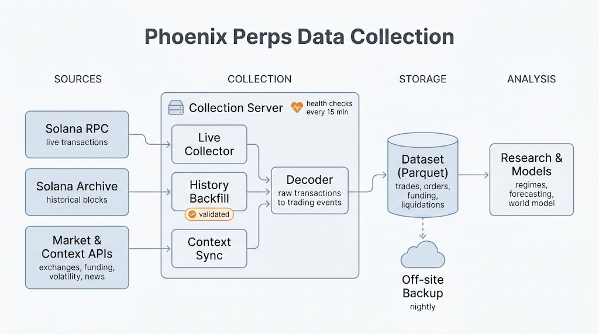

# solos-data

We collect Phoenix perpetuals transactions from Solana and turn them into tables
you can query with SQL.

Two jobs run together: one saves new transactions, the other works backward from
now into older history. Each finished batch becomes available right away.

```text
Solana → raw transactions → decoded events → Parquet files → SQL
```



The nightly backup copies the raw transactions and the context data, not the decoded
tables; those are rebuilt from the raw files (ADR-0010).

## Tech stack

| Layer | What we use |
| --- | --- |
| Language | Rust 1.96 (edition 2024), one binary: `solos-data` |
| Runtime and HTTP | Tokio, reqwest (rustls, HTTP/2) |
| Live data | Solana JSON-RPC |
| History | Old Faithful archive, replayed through Jetstreamer |
| Decoding | In-repo `phoenix-codec` and `solana-wire` crates |
| Storage | Parquet with ZSTD, partitioned by epoch |
| Queries | DuckDB 1.4.5 (bundled), SQL over the Parquet files |
| Context data | Binance, Hyperliquid, Bybit, Deribit, DefiLlama, SEC EDGAR, Polymarket, Kalshi, Fear & Greed, Elfa; on Solana, Jupiter Perps, Flash Trade and Pyth prices (ADR-0012), and spot DEX swaps across Raydium, Orca, Meteora, pump.fun, PancakeSwap and the proprietary AMMs, from the archive back to 2025-10-01 (ADR-0014) and from the RPC forward (ADR-0015) |
| Operations | systemd services and timers, a health check every 15 minutes, Docker Compose for local runs |
| Backup | rclone to Cloudflare R2, nightly |
| CI | GitHub Actions: fmt, clippy, tests |

## 1. Set up

You need Docker and an Alchemy Solana mainnet RPC URL.

```sh
cp .env.example .env
```

Edit `.env` and add your RPC URL. Keep this file on your machine.
Set the collection rate to fit your Alchemy plan.

## 2. Start collecting

```sh
docker compose up -d --build
```

The collector saves raw transactions. The decoder reads them and writes tables.
Both jobs resume from saved progress after a restart.

## 3. See the progress

```sh
docker compose exec collector solos-data collector status
docker compose exec decoder solos-data decoder status
```

## 4. Ask a question

For example: which markets have the most recorded fills?

```sh
docker compose exec decoder solos-data decoder query --sql \
  'SELECT asset_symbol, count(*) AS fills FROM fills GROUP BY asset_symbol ORDER BY fills DESC LIMIT 10'
```

| Table | What it contains |
| --- | --- |
| `decoded_transactions` | Decode result for each transaction |
| `events` | Decoded events, including failed attempts |
| `fills` | Completed order-book and spline fills |
| `order_events` | Order placements, changes and cancellations |
| `funding_events` | Funding payments |
| `decode_errors` | Payloads that need more decoder work |

Files live in `data/`. We use Parquet with ZSTD compression and DuckDB for SQL.
Use the query command to get the latest rows without counting corrections twice.
You can move the files and run the same code on another machine.

This is work in progress. Older data is still being collected. Decoded events do
not yet reconstruct full order books or positions. Full independent checks are
still pending. See the [remaining work](docs/issues/001-phoenix-acceptance.md).

[How it works](docs/architecture.md) · [Table details](docs/decoded-tables.md) ·
[Server setup](ops/runbook.md)

The collector and decoder are one Rust binary, `solos-data`. History below the last
published Old Faithful epoch is replayed from the archive through Jetstreamer; the
live tail follows RPC. The same binary's `augment` group collects free exogenous
market data for the Phoenix markets (Binance futures dumps, Hyperliquid funding,
Deribit DVOL, DefiLlama stablecoins) into Parquet next to the dataset (ADR-0009). For development, use Rust 1.96: `cargo test --workspace`.
The code is [MIT licensed](LICENSE). This repo contains code and test fixtures;
collected data is stored separately.

## Crash-safety testing

Two offline loops kill the real binary and check the restart predicate (ADR-0016).
The matrix (`cargo test --test failpoints`) kills at seven named publication points;
the nightly loop (`cargo test --test nightly_random_kill -- --ignored --nocapture`,
ADR-0018) kills at a seeded random point over 200-500 iterations and asserts the
byte-identical re-run. Each iteration logs its seed; replay one with:

```sh
SOLOS_DATA_NIGHTLY_SEED=<seed> cargo test --test nightly_random_kill -- --ignored --nocapture
```
